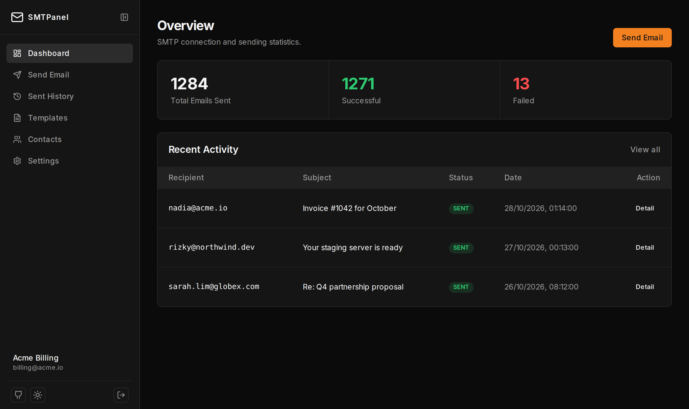
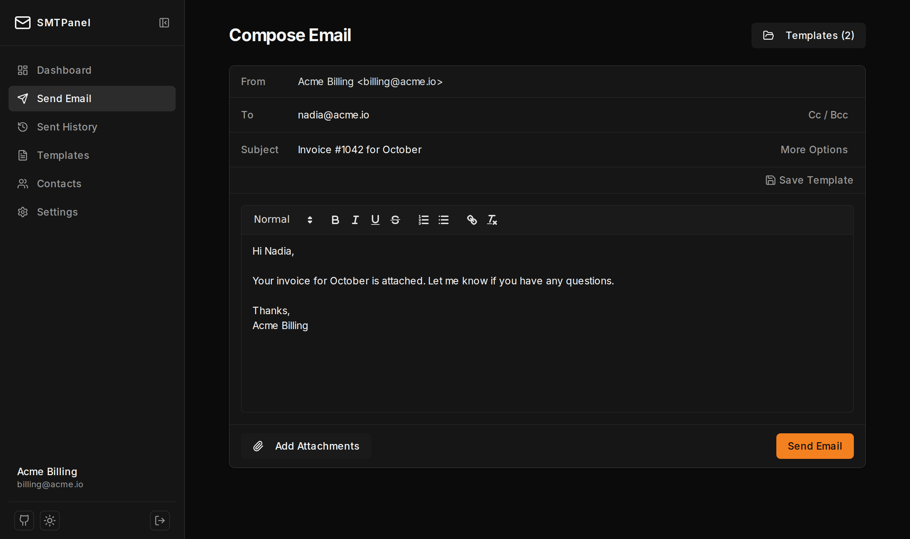

# SMTPanel

**A self-hosted web client for your own SMTP server. No database, no signup, no telemetry.**

Paste your SMTP credentials, write an email, hit send. Contacts, templates and history live in your browser; the server only relays the message.

[](https://github.com/afrizalyogi/smtpanel/actions/workflows/ci.yml)
[](LICENSE)

**[Live demo →](https://smtpanel.aycorp.id)** · [Docker](#docker) · [Vercel](#vercel)



## Why

You need to send a few emails through Gmail, SES, Mailgun, Postmark or your own Postfix: test a new SMTP setup, reply from a shared address, or send a one-off announcement. A full newsletter platform is overkill, and a desktop mail client wants an IMAP inbox too.

SMTPanel is one small Next.js app:

| | SMTPanel | Listmonk / Mautic / Mailtrain |
|---|---|---|
| Database | none | PostgreSQL / MySQL (+ Redis) |
| Background workers | none | yes |
| Runs on | Vercel free tier, or a 512 MB VPS | a dedicated server |
| Best for | ad-hoc and transactional sending | newsletters, bulk campaigns, analytics |

SMTPanel does **not** do bulk campaigns, list management or open tracking. If you need those, use Listmonk.

## Features

- **Any SMTP server**: host, port, TLS and auth are tested before you continue
- **Rich-text composer** with Cc/Bcc, Reply-To, `In-Reply-To` threading, priority, read receipts and attachments
- **Templates and contacts** with recipient autocomplete
- **Sent history** with per-message detail and one-click resend
- **JSON import/export** for history, templates and contacts, plus a PIN-encrypted token to move your SMTP session to another device
- Dark and light themes, mobile layout



## Privacy model

- SMTP credentials are encrypted with AES-256-GCM using your `ENCRYPTION_KEY` and stored in an `HttpOnly`, `SameSite=Strict` cookie. Nothing is written to disk on the server.
- Contacts, templates and history are stored in your browser's `localStorage`. Clearing site data or logging out deletes them.
- **Settings → SMTP Configuration** can move a session to another device: the browser encrypts your credentials (and optionally your data) with a PIN you choose (PBKDF2 + AES-GCM) before showing the token. The server never sees the PIN.
- Anyone who can reach your instance can use it to send through *their own* SMTP account. If you host it publicly, that is the intended use; put it behind auth if you don't want that.

## Self-hosting

The only required setting is `ENCRYPTION_KEY`, a random string of at least 32 characters:

```bash
openssl rand -base64 32
```

Changing the key logs every session out.

### Docker

```bash
docker run -d -p 3000:3000 -e ENCRYPTION_KEY="$(openssl rand -base64 32)" ghcr.io/afrizalyogi/smtpanel:latest
```

Open <http://localhost:3000>. To build the image yourself: `docker build -t smtpanel .`

### Vercel

[](https://vercel.com/new/clone?repository-url=https%3A%2F%2Fgithub.com%2Fafrizalyogi%2Fsmtpanel&env=ENCRYPTION_KEY&envDescription=Random%20string%2C%20at%20least%2032%20characters)

Vercel limits request bodies to 4.5 MB, so attachments are capped at 4 MB in total.

### From source

Requires Node.js 20.9+.

```bash
git clone https://github.com/afrizalyogi/smtpanel.git
cd smtpanel
npm install
cp .env.example .env.local   # then set ENCRYPTION_KEY
npm run dev
```

## Tech stack

Next.js (App Router), React 19, Tailwind CSS 4, Zustand (persisted to `localStorage`), TanStack Query, Nodemailer, Node.js `crypto`.

## Contributing

Issues and pull requests are welcome. Before opening a PR, run:

```bash
npx tsc --noEmit && npm run lint && npm run build
```

## License

[MIT](LICENSE) © Afrizal Yogi
